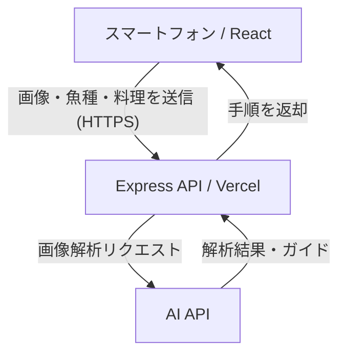

# 🐟 さばおじ

> **魚が教える、魚の捌き方。**

**さばおじ**は、スマートフォンのカメラとAIを活用して、目の前の魚に合わせた捌き方を案内するWebアプリケーションです。

魚の頭をしたおじさん「さばおじ」が魚の捌き方を教えてくれる、ちょっとシュールな料理サポートアプリを目指しています。

> [!NOTE]
> 現在は企画・開発段階です。以下の機能・技術構成は予定を含みます。

## 🎯 解決したい課題

魚の捌き方は、魚種や作りたい料理によって異なります。既存のレシピサイトや動画では、実際に手元にある魚の向き・状態に合う説明を探しにくく、初心者にはハードルがあります。

**自分が今捌こうとしている魚を見ながら、次に何をすればいいか分かる**体験を提供します。

## ✨ 主な機能（予定）

- **魚の選択**：捌きたい魚種を選ぶ
- **料理・捌き方の選択**：三枚おろし、刺身、煮付け用など、目的に合う手順を選ぶ
- **カメラ撮影**：スマートフォンで魚を撮影する
- **AIによる案内**：撮影画像と選択内容をもとに、捌く手順を段階的に説明する
- **さばおじのガイド**：魚の頭を持つおじさんキャラクターが、分かりやすく案内する

### 利用の流れ

1. 捌きたい魚を選択
2. 作りたい料理・捌き方を選択
3. スマートフォンで魚を撮影
4. AIが画像を参考に手順を案内
5. ガイドを見ながら調理を進める

## 👨‍🍳 キャラクター「さばおじ」

魚なのに魚の捌き方を教えてくれる、少し不思議なおじさん。

- **頭**：魚
- **体型**：40代男性をイメージした、ややぽっちゃりした体型
- **服装**：灰色の長袖パーカー、黒いズボン
- **ポーズ**：パーカーのポケットに両手を入れた、少し猫背の立ち姿

## 🛠️ 技術構成（予定）

| 分野 | 技術 |
| --- | --- |
| Frontend | React / TypeScript / Vite |
| Backend | Node.js / Express |
| AI | 画像認識対応のAI API（選定中） |
| 通信 | HTTPS / REST API |
| Deployment | Vercel |

### システム構成イメージ

最初は**写真撮影 → AI解析 → 手順表示**の構成を目指します。

## 🚀 今後の展望

- 対応する魚種・食材の拡充（淡水魚、深海魚、サメ、ザリガニ、エビなど）
- AIへの追加質問・対話機能
- カメラ映像を用いたリアルタイムの調理支援
- 音声によるハンズフリー操作

## ⚠️ 安全性について

包丁を扱うため、AIの回答だけを根拠に危険な作業を進めない設計を目指します。魚種の誤認識、毒性、寄生虫などのリスクもあるため、初期段階では対象の魚種と案内する手順を限定し、安全性を確認した情報をベースにガイドします。

---

**魚を捌くのは難しい。だったら、魚に教えてもらおう。**
