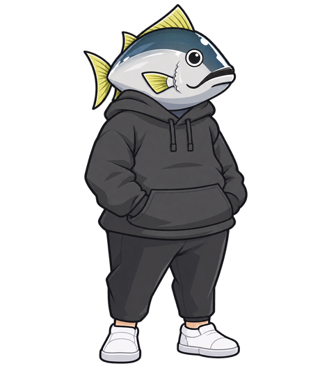
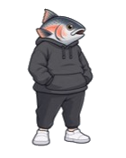
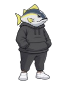
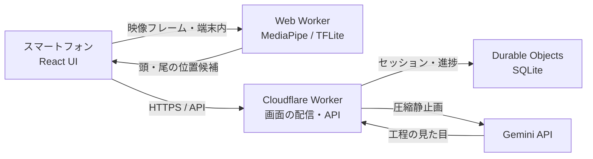

<div align="center">





# 俺をさばけ

**魚を選んで、カメラの横で手順を確認。**

スマートフォンのカメラと魚種別ガイドで、魚をさばく手順を案内するWebアプリです。
魚のキャラクターと一緒に、目の前の魚と手元を見ながら進められます。

[公開デモ](https://orewosabake-guide.nitr0yukkuri.workers.dev/) · [使い方](#使い方) · [開発ガイド](C/src/orewosabake/README.md)

</div>

## できること

| 機能 | 内容 |
| --- | --- |
| 魚を選ぶ | 名前の検索やカテゴリから、アジ・サーモン・ハマチなどを選択 |
| 手順を確認する | カメラ映像の横に、現在の工程と次の操作を表示 |
| 頭・尾を検出する | MediaPipeで位置の候補を推定し、端末内で検出枠を表示 |
| 工程の見た目を確認する | 縮小した静止画をGeminiへ送り、現在の工程の完了見込みを推定 |
| 工程を進める | 対象工程ではAI判定をもとに自動進行。ボタンや対応ブラウザーでの「次へ」の音声操作も利用可能 |
| 使い方を見返す | 右上の「？」から説明を表示 |

現在は**実装・検証中の試作**です。魚の一覧にはガイド未対応の魚種もあり、マグロ・鮎は現在のガイド対象外です。

## 使い方

1. [公開デモ](https://orewosabake-guide.nitr0yukkuri.workers.dev/)を開き、さばきたい魚を選びます。
2. 「俺を捌け！」を押し、カメラの使用を許可します。縦画面では案内に沿ってスマートフォンを横向きにします。
3. 魚と手元を映し、カメラの横に出る手順を確認します。
4. 自動進行の対象工程では、Geminiが工程完了と判定すると次へ進みます。うろこ・骨の確認などは、自分で確認して「次の工程へ」を押します。

ガイドを始めると、対応ブラウザーでは「次へ」の音声認識も開始します。音声操作にはマイクの許可が必要です。ガイドを閉じるとカメラと音声認識を停止します。

## AIが見ているもの

**頭・尾の位置検出と、工程の見た目の確認は別の処理です。**

| 処理 | 実行場所 | 役割 |
| --- | --- | --- |
| MediaPipe Tasks Vision | ブラウザー内のWeb Worker | 学習済みTFLiteモデルで頭・尾の位置候補を検出 |
| Gemini API | Cloudflare Worker経由で呼び出し | 撮影した静止画から工程の見た目を推定。サーモンでは工程開始時と現在の画像を比較 |
| 工程の進行管理 | React UI / Worker API | 有効なセッションと現在工程を確認し、1工程ずつ進行 |

カメラの連続映像は端末内で処理します。頭・尾の検知が安定した後、人物チェックを通過した圧縮静止画をGeminiへ自動送信します。音声認識は、ブラウザーによって外部の認識サービスを利用する場合があります。

MediaPipeの公開モデルは**頭・尾の検出用**です。サーモンの各工程を認識する専用モデルを学習済みという意味ではありません。Geminiの工程確認は、工程画像で追加学習していないゼロショットの試作です。

## 技術構成

フロントエンドとバックエンドはTypeScriptを使い、APIのスキーマと型を共有しています。

| 分野 | 技術・役割 |
| --- | --- |
| フロントエンド | React / TypeScript / Vite |
| 端末内の画像処理 | MediaPipe Tasks Vision / TFLite / Web Worker |
| 本番の配信・API | Cloudflare Workers / Workers Static Assets |
| 本番のセッション保存 | Durable Objects / SQLiteストレージ |
| ローカルAPI | Node.js標準HTTPサーバー / TypeScript |
| 共有契約 | Zodによる入力・出力検証とTypeScriptの型 |
| 工程の画像確認 | Google Gemini API |
| CI/CD | GitHub Actionsによる型検査・ビルド・モデル検証・Cloudflareへの公開 |



Node.js版APIはローカルでの動作確認に利用でき、セッションをメモリ内に保持します。Webの開発・本番配信にはCloudflare Workerを使います。

## ローカル起動

Node.js **24.22.1**、npm **11.19.1**を使用します。実装は `C/src/orewosabake` にあります。

```bash
git clone https://github.com/nitr0yukkuri/CAMP-vol6.git
cd CAMP-vol6/C/src/orewosabake
npm ci
npm run dev:web
```

[http://127.0.0.1:5173](http://127.0.0.1:5173)で開きます。このアドレスは開発PC内の確認用です。スマートフォンの実機確認にはHTTPSの配信先を使ってください。

- **Geminiの画像確認**：ローカルWorkerの `apps/web/.dev.vars` にAPIキーを設定します。
- **頭・尾の検出**：モデル本体はGit管理外です。`apps/web/public/models/head-tail.tflite` を用意します。
- **Node.js版API**：別ターミナルで `npm run dev:api` を実行します。

設定・モデルの用意・デプロイ方法は、[開発ガイド](C/src/orewosabake/README.md)にまとめています。

## 開発資料

| 資料 | 内容 |
| --- | --- |
| [開発ガイド](C/src/orewosabake/README.md) | 起動、環境変数、API、Cloudflareへのデプロイ |
| [技術構成](C/src/orewosabake/docs/TECHNICAL_ARCHITECTURE.md) | 実行環境とデータの流れ |
| [頭・尾モデルの学習](C/src/orewosabake/ml/README.md) | 学習元データ、分割、学習・評価、利用条件 |
| [サーモンのデータ調査](C/src/orewosabake/data/analysis/salmon-data-search-20261104.md) | 工程認識用データの候補と収集方針 |
| [スマホ撮影データのラベル仕様](C/src/orewosabake/data/phone-capture/README.md) | 撮影条件、CSV、ラベル付け |

参考手順は公開資料をもとにした要約で、調理経験者によるレビュー前です。AIの検出や完了見込みは、作業完了・安全性・鮮度を保証しません。画像だけで確認できないうろこや小骨などは、手元を確認して進めてください。
